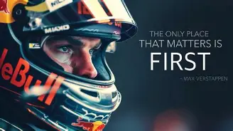

## Welcome!

Systems Development Student — Python · JavaScript · Full-Stack · Automation

[LinkedIn](https://www.linkedin.com/in/gabrielmenezessousa/) ·

---

Building practical web apps, automation tools, and database-backed systems.
Currently looking for internship and junior developer opportunities.

---

**What I'm building**

- Expanding my backend and database project portfolio

---

**Tech Stack**

| Layer         | Technologies                        |
|---------------|-------------------------------------|
| Languages     | Python, Java, C++, C#               |
| Frontend      | Vanilla JS, responsive layouts      |
| Automation    | Python scripting and APIs           |
| Databases     | SQL, structured data modeling       |
| Tools         | Git, VS Code, Arduino               |

---

**Featured Projects**

- ** TCC (Final Project) Project: Screen time control - FocusMind - Android Java, Java, PHP, JS, WebProject 
- ** System for technical support calls - Android Java, PHP, JS, C#, WebProject

---

[LinkedIn](https://www.linkedin.com/in/gabrielmenezessousa/) · · [github.com/Menezes-Gabs](https://github.com/Menezes-Gabs)
